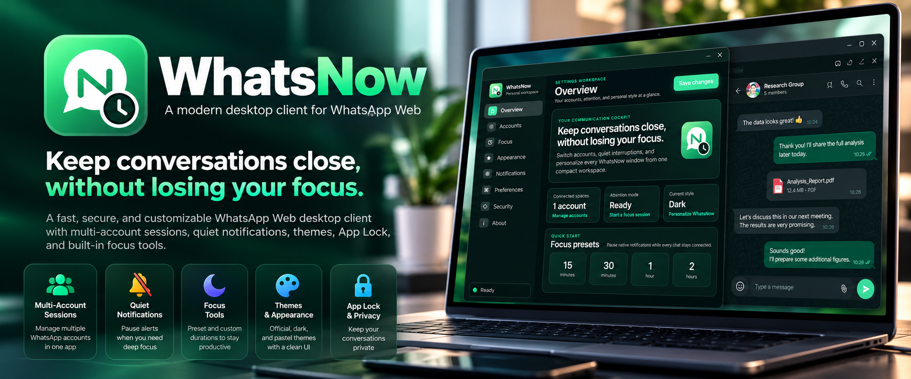

# WhatsNow 2.6.1 release notes

_Prepared 2026-10-17 · WhatsNow is authored and maintained by Benedictus Reynaldo Hartanto ([@benedictusrey](https://github.com/benedictusrey))._

---

## 📋 Release overview

*Illustrative artwork, not a pixel-exact UI or benchmark. The refreshed README
uses four new supplied images; see its captions for feature and memory limits.*

A maintenance update focused on phone-link delivery, dedicated calling-window
geometry, and clearer Settings. Existing chat themes, doodle mapping, emoji
protection, compact native notifications, account tools, Focus, App Lock, and
drag-and-drop behavior are retained.

The full implementation record is [CHANGELOGS_v2.6.1.md](CHANGELOGS_v2.6.1.md).
Explore all current features in [WhatsNow_latest.md](WhatsNow_latest.md).

## 🔧 Changes

- Open phone targets through a trusted visible-row click or native New chat
  lookup without a document-refresh fallback.
- Preserve conflicting drafts; insert supplied link text only into an empty
  composer and never send it automatically.
- Cancel lookup with Escape and supersede older requests with newer links.
- Ignore nonmodal dialog-role shells and hidden/off-screen panels instead of
  incorrectly refusing requests as busy; protect actual active editing panels.
- Queue handoffs until the intended account bridge is ready.
- Route both `call.whatsapp.com` and supported `web.whatsapp.com/call` stages
  into a dedicated decorated, resizable, minimizable, maximizable call window.
- Fit initial call geometry to the opener's monitor, DPI, work area, and native
  borders; prevent stale per-call saved positions from overriding the fit.
- Improve Settings action text, selected icons, badges, keyboard focus, and small
  copy. Tested normal-text contrast pairs meet 4.5:1 across ten resolved palettes.
- Use the concise Benedictus RH identity in Settings, with working GitHub profile
  links preserved when the compiled app version is inserted.
- Add regression gates for phone routing, Settings contrast, and attribution links.

## ✅ Validation status

Local Windows setup, MSI, and portable packages are built and checksum-verified.
The final attribution source passed 110 installer-mode Rust tests. Browser
regressions cover routing, protected drafts, no-refresh behavior, notifications,
attachments, Settings navigation, themes/doodles, and author links. Earlier
portable-mode and strict Clippy results are retained in the [audit](docs/AUDIT_2.6.1.md).

**Before public release:** complete final installed live phone-link acceptance,
a real two-party video call with resize/maximize/media checks, incoming-toast
activation, and native Linux/macOS build and installation acceptance. Controlled
browser fixtures do not prove WhatsApp service behavior. Do not remove this
status section until those checks are actually completed.

## 📦 Packages

| Platform | Planned release files |
| --- | --- |
| Windows x64 | `WhatsNow_2.6.1_windows_x64-setup.exe`, `WhatsNow_2.6.1_windows_x64_en-US.msi`, `WhatsNow_2.6.1_windows_x64-portable.exe` |
| Linux x64 | `WhatsNow_2.6.1_amd64.AppImage`, `WhatsNow_2.6.1_amd64.deb` |
| macOS Apple Silicon | `WhatsNow_2.6.1_aarch64.dmg`, `WhatsNow_2.6.1_aarch64.app.tar.gz` |
| macOS Intel | `WhatsNow_2.6.1_x86_64.dmg`, `WhatsNow_2.6.1_x86_64.app.tar.gz` |
| Integrity | `checksums.sha256` for the completed same-revision package set |

Only files actually attached to this release are available downloads. Linux/macOS
packages are not established by the local Windows build. Build all release
platforms from one immutable source revision; do not mix earlier candidates.

## 🔐 Security and compatibility

The current local Windows candidates are **unsigned**. Signing/notarization
status must be rechecked for the final release assets. SHA-256 comparison checks
integrity, not publisher identity or malware absence. Keep antivirus protection
enabled; do not add broad exclusions. See [Security](SECURITY.md) and [Privacy](PRIVACY.md).

Windows needs an updated Microsoft Edge WebView2 runtime. Multiple WebView2
processes are normal; there is no fixed RAM guarantee. Native toast duration
remains OS-controlled even when a preferred duration is configured.

An external HTTPS `wa.me` link first opens the browser. Choose its **Open
WhatsApp** action for an installed Windows handoff. Portable mode deliberately
does not register that protocol. Calling availability depends on WhatsApp Web,
account eligibility, hardware, permissions, and the platform webview.

## 🔄 Upgrade

Fully **Quit WhatsNow from the tray** before installing or replacing a portable
binary. A same-version development candidate requires reinstalling the new
package; the running process does not acquire newly built code automatically.
Per-user sessions and preferences normally remain. Do not delete application
data as a routine upgrade step.

Use the [installation guide](docs/INSTALLATION.md) and follow the
[release preparation checklist](docs/RELEASE_PREPARATION_2.6.1.md).

WhatsNow is independent and not affiliated with WhatsApp or Meta.
Copyright (c) 2026 Benedictus Reynaldo Hartanto. See [MIT](LICENSE) and
[retained notices](THIRD_PARTY_NOTICES).
